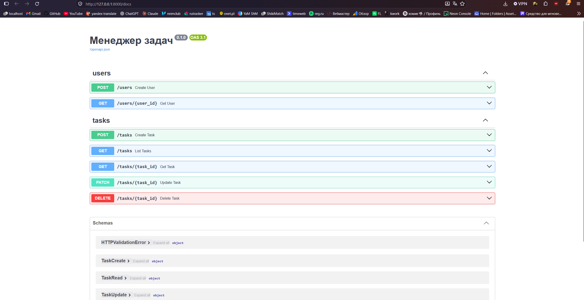
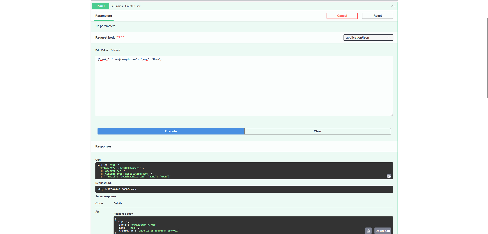
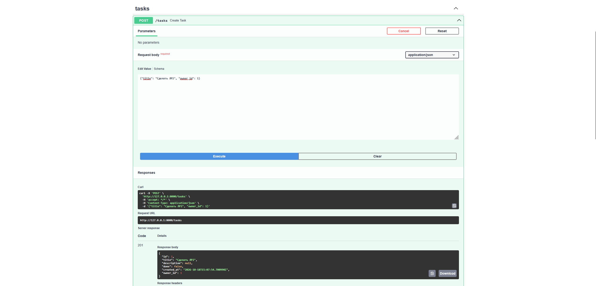
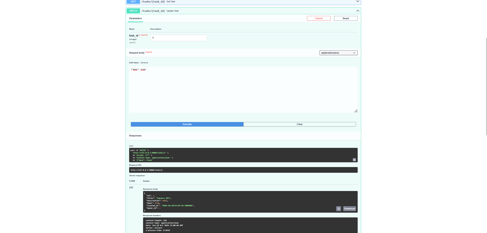
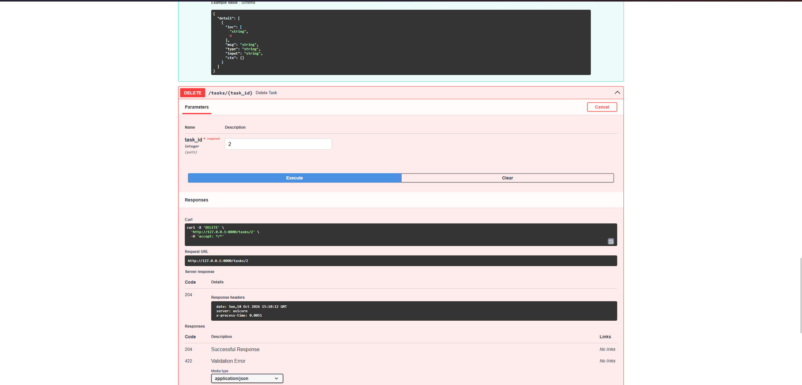
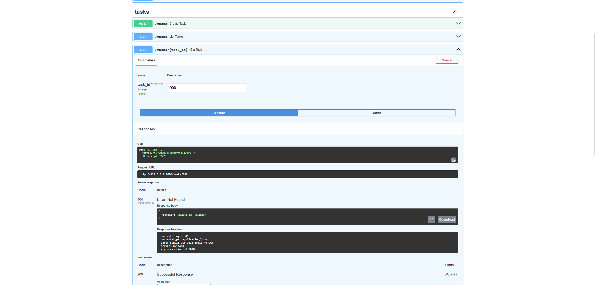
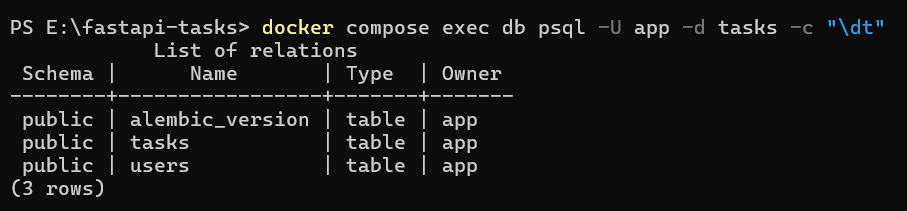

# Менеджер задач — REST API на FastAPI

Практическая работа № 2. Сервис хранит пользователей и их задачи в PostgreSQL и
предоставляет REST API. Стек: FastAPI, SQLAlchemy 2.0 (async, asyncpg), Pydantic v2,
pydantic-settings, Alembic, Docker Compose.

## Структура

```text
.
├── app/
│   ├── __init__.py
│   ├── main.py          # приложение, middleware, подключение роутеров
│   ├── config.py        # настройки (pydantic-settings), DATABASE_URL
│   ├── db.py            # асинхронный движок, фабрика сессий, Base, get_session
│   ├── models.py        # ORM-модели User и Task
│   ├── schemas.py       # Pydantic-схемы *Create, *Read, *Update
│   └── routers/
│       ├── users.py
│       └── tasks.py
├── migrations/          # Alembic (шаблон async), первая миграция в versions/
├── alembic.ini
├── docker-compose.yml   # PostgreSQL 16
├── requirements.txt
├── .env.example
└── README.md
```

## Эндпоинты

| Метод | Путь | Описание | Коды ответа |
| --- | --- | --- | --- |
| POST | `/users` | создать пользователя | 201, 409 (email занят), 422 |
| GET | `/users/{id}` | получить пользователя | 200, 404 |
| POST | `/tasks` | создать задачу | 201, 404 (нет владельца), 422 |
| GET | `/tasks` | список задач, фильтры `done`, `owner_id`, пагинация `limit` (1–100), `offset` | 200 |
| GET | `/tasks/{id}` | получить задачу | 200, 404 |
| PATCH | `/tasks/{id}` | частично обновить задачу | 200, 404, 422 |
| DELETE | `/tasks/{id}` | удалить задачу | 204, 404 |

Каждый ответ содержит заголовок `X-Process-Time`, а в лог пишется строка вида
`INFO app: GET /tasks/1 200 0.0035 s`.

## Запуск

Нужны Python 3.11+, Docker и Docker Compose.

1. Клонировать репозиторий:

   ```bash
   git clone https://github.com/MaksChocomint/fastapi-tasks.git
   cd fastapi-tasks
   ```

2. Создать файл с настройками:

   ```bash
   cp .env.example .env          # Windows: copy .env.example .env
   ```

   Если порт 5432 уже занят (например, локальным PostgreSQL), поменяйте в `.env` порт
   в `DB_PORT` и в `DATABASE_URL`, например на 5434.

3. Запустить PostgreSQL и проверить, что база отвечает:

   ```bash
   docker compose up -d db
   docker compose exec db psql -U app -d tasks -c "select 1"
   ```

4. Создать виртуальное окружение и установить зависимости:

   ```bash
   python -m venv .venv
   source .venv/bin/activate     # Windows: .venv\Scripts\activate
   pip install -r requirements.txt
   ```

5. Применить миграции (таблицы создаёт Alembic, не `create_all`):

   ```bash
   alembic upgrade head
   ```

6. Запустить сервис:

   ```bash
   uvicorn app.main:app --reload
   ```

7. Открыть Swagger UI: <http://127.0.0.1:8000/docs>

Как создавалась миграция (повторять не нужно, она уже в `migrations/versions/`):

```bash
alembic init -t async migrations
alembic revision --autogenerate -m "create users and tasks"
```

## Скриншоты

### Swagger UI

Все эндпоинты:



Создание пользователя — 201:



Создание задачи — 201:



Список задач с фильтром — 200:


Частичное обновление задачи — 200:



Удаление задачи — 204:



Запрос несуществующей задачи — 404:



### Таблицы в БД

```bash
docker compose exec db psql -U app -d tasks -c "\dt"
```



## Ответы на контрольные вопросы

**1. Чем FastAPI отличается от Starlette и какие компоненты Starlette он использует?**

Starlette — это лёгкий ASGI-фреймворк: маршрутизация, запросы и ответы, middleware,
WebSocket, фоновые задачи, тестовый клиент. FastAPI построен поверх Starlette (класс
`FastAPI` наследуется от `Starlette`) и добавляет то, чего в Starlette нет: валидацию
входных данных и сериализацию ответов через Pydantic по аннотациям типов, систему
зависимостей `Depends`, автоматическую генерацию OpenAPI-схемы и документации
(Swagger UI, ReDoc). Из Starlette FastAPI использует `Request`, `Response` и их
разновидности, роутинг, middleware (в этой работе — `BaseHTTPMiddleware`),
`BackgroundTasks`, `HTTPException` (FastAPI расширяет его), `TestClient`, `StaticFiles`.

**2. Зачем разделять схемы Create, Read и Update?**

У каждой операции свой набор полей и свои правила. При создании клиент не передаёт `id`
и `created_at` — их назначает база, а обязательные поля (`title`, `owner_id`) должны быть.
При чтении, наоборот, `id` и `created_at` возвращаются. При обновлении все поля
необязательны, потому что клиент меняет только часть. Если сделать одну общую схему,
то либо клиент сможет подсунуть `id`, либо придётся делать всё необязательным и терять
валидацию. Кроме того, Read-схема определяет, что уходит наружу, и защищает от
случайной выдачи служебных полей.

**3. Что делает `from_attributes=True`?**

Разрешает Pydantic создавать модель из произвольного объекта, читая его атрибуты
(`obj.id`, `obj.title`), а не только из словаря. Благодаря этому из эндпоинта можно
вернуть ORM-объект SQLAlchemy, и FastAPI сам превратит его в `TaskRead`
(`TaskRead.model_validate(task)`). В Pydantic v1 эта настройка называлась `orm_mode`.

**4. Почему сессия передаётся через `Depends`, а не создаётся глобально?**

Сессия SQLAlchemy не потокобезопасна и хранит состояние (транзакцию, загруженные
объекты), поэтому одна глобальная сессия на все параллельные запросы привела бы
к смешиванию транзакций и ошибкам. Через `Depends(get_session)` каждый запрос получает
свою сессию, а код после `yield` гарантированно закрывает её, даже если в обработчике
возникло исключение. Ещё одна причина — тестируемость: в тестах зависимость легко
подменить через `app.dependency_overrides`, например на сессию к тестовой базе.

**5. Чем `exclude_unset=True` отличается от `exclude_none=True`?**

`exclude_unset=True` выбрасывает поля, которые клиент вообще не передал в запросе.
`exclude_none=True` выбрасывает поля, значение которых равно `None`, неважно, передал
их клиент или нет. Для PATCH нужен `exclude_unset`: запрос `{"done": true}` должен
изменить только `done`, а запрос `{"description": null}` — явно очистить описание.
С `exclude_none` второй запрос ничего бы не сделал, потому что `None` был бы отброшен.

**6. Почему в production таблицы не создают через `create_all`?**

`create_all` только создаёт отсутствующие таблицы и ничего не делает с уже существующими:
не добавит новый столбец, не поменяет тип, не удалит индекс. В работающей базе с данными
схема меняется постепенно, и каждое изменение нужно применять одинаково на всех стендах.
Миграции Alembic хранят историю изменений в репозитории, их можно просмотреть
на ревью, применить (`upgrade`) и откатить (`downgrade`), а таблица `alembic_version`
показывает, какая версия схемы сейчас в базе.
